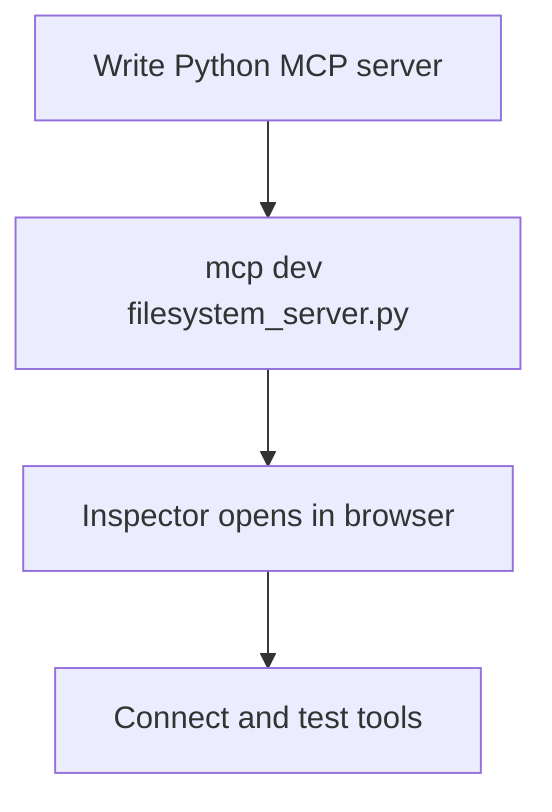
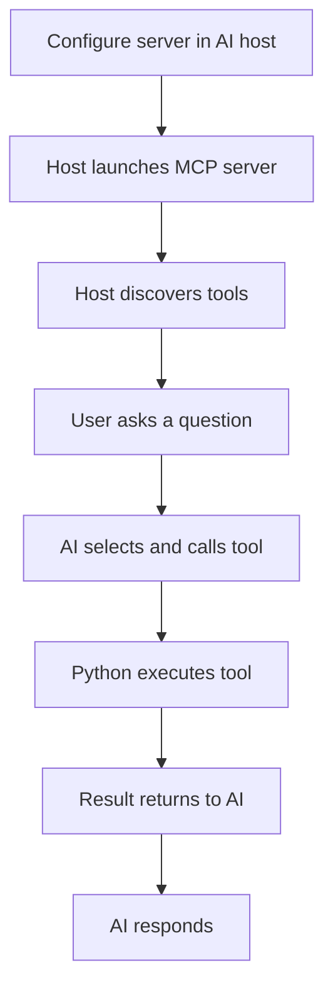

# MCP Fundamentals — Setup & Architecture

A practical reference for building, testing, and connecting a basic Python MCP server.

## 1. What you need

| Component | What it does |
|---|---|
| **Python** | Programming language used to implement and run the MCP server. |
| **MCP Python SDK (`mcp`)** | Framework/library for exposing tools, resources, and prompts using the MCP protocol. |
| **`uv`** | Python package and environment manager used to install dependencies and run applications. |
| **Node.js / npm / npx** | Used by the MCP Inspector launcher (`mcp dev`) to start its browser-based developer interface. Not needed to implement or run the Python server itself in every workflow. |
| **Your MCP server code** | Python file containing the server, tool definitions, business logic, and access controls. |

### Install the Python SDK

Using pip:

```cmd
py -m pip install "mcp[cli]"
```

The `[cli]` extra provides the MCP command-line tools used for development.

## 2. Build the server

Create a Python file such as `mcp-server.py` (or `filesystem_server.py`).

It defines:
- The MCP server instance.
- Tools using decorators such as `@mcp.tool()`.
- Tool inputs, types, descriptions, and return values.
- Business logic and security/validation.

A tool is an ordinary Python function registered with the MCP SDK so an MCP client can discover and call it.

## 3. Launch MCP Inspector

From your project folder:

```cmd
mcp dev filesystem_server.py
```

**What this command does:**
- `mcp`: invokes the MCP CLI.
- `dev`: starts the development workflow, including the MCP Inspector.
- `filesystem_server.py`: identifies the server script being tested.

The Inspector is a browser UI for discovering, inspecting, and manually invoking tools. Its launcher needs `npx` available on PATH.

## 4. Connect Inspector to the server

In the Inspector UI, use the connection toggle to start/connect to the server.

The launch command displayed in our setup was:

```cmd
uv run --with mcp==2.3.0 mcp run filesystem_server.py
```

### Command breakdown

| Part | Meaning |
|---|---|
| `uv` | Runs the command using uv. |
| `run` | Executes a command in a managed environment. |
| `--with` | Makes the specified package available for this run. |
| `mcp==2.3.0` | Specifies the MCP package version for this run. |
| `mcp` | Invokes the MCP CLI executable. |
| `run` (MCP CLI) | Runs the MCP server application. |
| `filesystem_server.py` | Server script to execute. |

**In plain English:** Use `uv` to make MCP version 2.3.0 available, then invoke the MCP CLI to run the Python server script.

This is a convenient launch approach; it does not mean Node.js is executing the server logic.

## 5. Test tools

In Inspector:
1. Connect to the server.
2. Open the Tools section.
3. Select a tool.
4. Enter its arguments.
5. Run it and inspect the result or error.

Inspector helps validate tool schemas, inputs, behavior, and responses during development. It is a test client, not the AI agent.

## 6. Connect an AI agent (example: Claude Desktop)

After testing, configure an MCP-capable host to launch your server.

Example configuration (adjust paths and version to your environment):

```json
{
  "mcpServers": {
    "filesystem": {
      "command": "uv",
      "args": [
        "run",
        "--with",
        "mcp==2.3.0",
        "mcp",
        "run",
        "C:\\_DATA\\git\\mcp\\filesystem\\filesystem_server.py"
      ]
    }
  }
}
```

The host reads this configuration, launches the server process, and communicates with it using the MCP protocol. It can discover the tools and call them when relevant.

> Host configuration formats and supported transports vary. Confirm the configuration format for the specific host you use.

## 7. Development vs. AI-agent workflow

### Development and testing



### Use with an AI agent



The Inspector is a development tool. In normal usage, the AI host communicates with the MCP server directly.

## 8. Basic architecture

```text
AI Host / MCP Client
        |
        | MCP protocol (transport depends on configuration)
        v
Python MCP Server
        |
        +-- Tool definitions
        +-- Input validation
        +-- Business logic
        +-- Access controls
        |
        v
APIs / Files / Databases / Other systems
```

## 9. Learning roadmap

| Stage | Project | Skills to practice |
|---|---|---|
| 1 — Completed | Filesystem MCP | Server, tools, validation, testing |
| 2 | Calculator MCP | Inputs, outputs, types |
| 3 | REST API MCP | HTTP, APIs, JSON, authentication |
| 4 | API Monitoring MCP | Health checks, latency, errors, structured results |
| 5 | Database MCP | SQL and query security |
| 6 | Salesforce MCP | CRM integration |
| 7 | MuleSoft MCP bridge | Enterprise integration and orchestration |

**Suggested next project:** Build a REST API monitoring MCP server to practice API calls, HTTP response handling, structured output, error handling, and monitoring.

## 10. Useful commands

```cmd
py --version
py -m pip show mcp
uv --version
node --version
npm --version
npx --version

cd C:\_DATA\work\mcp\filesystem
mcp dev filesystem_server.py
```

## 11. Security notes

This is a learning setup, not a production-hardened server:
- Limit tools to the minimum required capabilities.
- Validate all tool inputs.
- Restrict filesystem paths and system access.
- Avoid exposing sensitive information.
- Use appropriate authentication, authorization, logging, and auditing for enterprise deployment.
